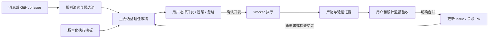

# auto-ai
auto-ai

用可迭代的标准模板安排事情，由一个主会话接收信息、监督 GitHub Issue，并调度 Worker 执行。

首版以 GitHub 作为任务入口与结果记录，先跑通一个任务的完整闭环。



## 四个核心概念

| 概念 | 负责什么 |
| --- | --- |
| Issue | 一件具体的事：目标、范围、验收要求、补充信息与结果 |
| 执行模板 | 一类事情的标准处理方法，可独立迭代升级 |
| 主会话 | 选择模板、补齐参数、安排 Worker、监督进展、核验结果 |
| Worker | 按任务与模板执行，返回产物、证据或具体阻塞 |

用户不需要管理底层 Session 或手动拆出完整步骤树。

规则命中只表示进入候选池；对应任务稿经用户确认开发后才能安排 Worker。执行者准备 PR，最终合并由用户和设计监督验收后明确发起。

## 模板与版本

- [默认模板目录](templates/catalog.yml)：主会话从这里找到当前采用的版本。
- [开发交付 v1.2.0](templates/development/1.2.0.md)：确认、并行执行、核验、交付；保留 v1.0.0/v1.1.0 固定引用。
- [调研交付 v1.0.0](templates/research/1.0.0.md)：收敛问题、核对来源、比较与结论。
- [GitHub 任务表单](.github/ISSUE_TEMPLATE/task.yml)：只收集输入，执行方法由主会话选择。

每次开工固定模板的路径、版本和 Git commit。模板升级只影响后续新任务；在途任务沿用原版本，除非主会话明确安排迁移。

模板改进的闭环：实际任务暴露问题 → 修改模板并验证案例 → 发布新版本 → 更新默认指针。

## 启动工作台

需要 Node.js 22+、Git、已认证的 GitHub CLI（gh）和已配置 provider 的 Pi。开发模型固定为 `facaiai-deepseek / deepseek-flash / high`。当前 Pi 进程监控实现使用 POSIX 进程组，macOS 已实际验证。

```sh
npm ci
npm start
```

默认地址为 `http://127.0.0.1:4310`，数据保存在 `.auto-ai/app/`。自动收集默认关闭；关闭工作台后已启动的 Pi monitor 可继续，重启按持久记录接管。

给 Issue 添加 `auto-ai:ready` 标签后，开启应用内自动监督的本地工作台默认每 60 秒收集一次，命中规则的 Issue 进入候选池并整理为可审阅的标准任务稿；这只表示进入待决策状态，只有在用户确认开发稿后才会派发 Worker。Worker 交付的 PR 仍需用户和设计监督单独批准合并。

1. 在“规则”添加仓库和基准引用，并填写要收集的仓库范围。只收集需求时本地路径可留空，开发前需要有效本地 Git 仓库。
2. 点击“收集 Issue”，或打开应用内自动监督。查看每条观测的命中/排除原因；PR 会被排除。
3. 只读角色整理任务稿，用户可以编辑。处理实质待决策项后，明确选择开发、暂缓或忽略。
4. 确认当前任务稿后自动调度：独立 Pi 会话、worktree 与分支，按并发上限、优先级、依赖和写入冲突排队。
5. Worker 返回结果后检查范围、提交推送、创建 PR 并进入验收。保存证据后回收干净且已推送的 worktree；失败或未知现场保留原因与路径。
6. 用户与设计监督对当前 PR head 记录结论后，仍需单独明确点击合并。合并结果不明时只读核对，不重发命令、不冒充完成。

本版是单人本地工作台，设计监督可由同一主会话完成；两个验收角色是结论记录，不是多用户身份认证。

可选启动参数：

```sh
npm start -- --host 127.0.0.1 --port 4310 --data-dir /absolute/data --app-repo-dir /absolute/auto-ai
```

服务仅绑定 loopback。HTTP 写操作校验 Host、Origin 和内存会话令牌；Worker 不获得工作台令牌。模板来自中央 app-repo-dir 的固定 Git commit，不要求每个目标仓库自带模板。

## 验证

```sh
npm test                  # 当前 101 项项目测试
npm run check:workflow    # 18 项独立领域检查
npm run check:trial       # 35 项执行包检查
npm run check:runtime     # 真实临时 Git + 隔离 Pi/GitHub 的闭环
npm run check:runtime:live # 真实 Pi + 真实临时 Git；GitHub PR/合并仍是隔离替身
```

真实 Pi 闭环已实际通过：只读任务稿 → 模拟用户确认 → 实际 Worker → 提交推送 → fixture PR → 回收 → 验收门槛 → 合并意图重启去重。两种角色的真实会话均核对为 deepseek-flash/high。GitHub 另已真实只读收集和读回 PR；**没有执行真实 GitHub 合并**。

浏览器已用生产前端和真实 Runtime/HTTP 完成 DOM 事件驱动的双仓库闭环，覆盖稿件版本门槛、暂缓/忽略、并行与依赖队列、阻塞重试、双角色验收、pending 刷新及完成只读结果；GitHub/Pi 在该界面场景中是明确替身。原生输入通道的独立探针未通过，不能将 DOM 验收声称为原生鼠标/键盘验收。真实 Pi 与 Git 的 6/6 来自另一条独立脚本。

结果和限制见 [Runtime 监督核验](docs/worker-trials/T005-runtime-supervisor.md)、[真实后端界面检查](docs/worker-trials/UI-actual-backend-check.md)。底层 Git 创建工作树后、manifest 写入前发生崩溃时，会保留未知现场并给出阻塞；不静默删除无法确认归属的目录。

任务稿格式见 [WORKER_BRIEF.md](docs/WORKER_BRIEF.md)。运行职责和 Interface 见 [DESIGN.md](docs/DESIGN.md)、[RUNTIME_CONTRACT.md](docs/RUNTIME_CONTRACT.md)、[HTTP_CONTRACT.md](docs/HTTP_CONTRACT.md)。从 [CONTEXT_CARD.md](docs/CONTEXT_CARD.md) 恢复当前项目进度。

隔离界面验收服务可复跑：

```sh
node scripts/serve-ui-fixture.mjs
```

它只创建本地临时 Git 与显式替身，不被生产启动引用。启动输出独立 URL 和 controlFile，Ctrl-C 保存状态与 Git bundle 后清理自建干净工作树；脏或未知目录保留。详细步骤和验证范围见 [界面闭环记录](docs/worker-trials/UI-full-backend-check.md)。

当前目标逐项证据与尚需用户决定的部分见 [完成审计](docs/ACCEPTANCE_AUDIT.md)。T007 是待确认的真实后续任务稿，尚未创建 Issue 或获得开发授权。
