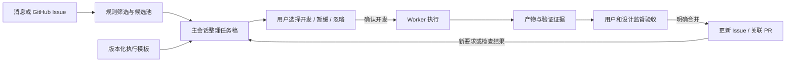

# auto-ai
auto-ai

用可迭代的标准模板安排事情，由一个主会话接收信息、监督 GitHub Issue，并调度 Worker 执行。

首版以 GitHub 作为任务入口与结果记录，先跑通一个任务的完整闭环。



## 四个核心概念

| 概念 | 负责什么 |
| --- | --- |
| Issue | 一件具体的事：目标、范围、验收要求、补充信息与结果 |
| 执行模板 | 一类事情的标准处理方法，可独立迭代升级 |
| 主会话 | 选择模板、补齐参数、安排 Worker、监督进展、核验结果 |
| Worker | 按任务与模板执行，返回产物、证据或具体阻塞 |

用户不需要管理底层 Session 或手动拆出完整步骤树。

规则命中只表示进入候选池；对应任务稿经用户确认开发后才能安排 Worker。执行者准备 PR，最终合并由用户和设计监督验收后明确发起。

## 模板与版本

- [默认模板目录](templates/catalog.yml)：主会话从这里找到当前采用的版本。
- [开发交付 v1.1.0](templates/development/1.1.0.md)：调查、实现、验证、交付；保留 v1.0.0 固定引用。
- [调研交付 v1.0.0](templates/research/1.0.0.md)：收敛问题、核对来源、比较与结论。
- [GitHub 任务表单](.github/ISSUE_TEMPLATE/task.yml)：只收集输入，执行方法由主会话选择。

每次开工固定模板的路径、版本和 Git commit。模板升级只影响后续新任务；在途任务沿用原版本，除非主会话明确安排迁移。

模板改进的闭环：实际任务暴露问题 → 修改模板并验证案例 → 发布新版本 → 更新默认指针。

## 当前状态

已用 Pi 的 `deepseek-flash / high` 完成首个开发任务与返修，提供可运行的执行包生成器。任务稿格式见 [WORKER_BRIEF.md](docs/WORKER_BRIEF.md)，实际记录见 [T001](docs/worker-trials/T001-task.md) 与其结果文档。

Node.js 22+ 与 Git 环境下，无需安装依赖：

```sh
npm test
npm run check:trial
node scripts/prepare-task.mjs --input examples/task.json --template templates/development/1.1.0.md --ref HEAD
```

CLI 当前显式接受模板路径；catalog 自动选择尚未实现。**尚未实现 Issue 监听、主会话运行时或自动 Worker 调度。创建 Issue 不会自动开始执行。**

运行设计、状态与恢复约定见 [DESIGN.md](docs/DESIGN.md)。下一步实施范围见 [EXECUTION_ROUTE.md](docs/EXECUTION_ROUTE.md)。
